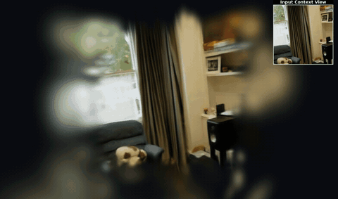
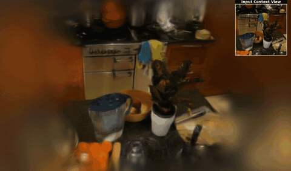

<p align="center">
  
</p>

<h1 align="center">S2Tok: Streaming 3D Gaussian Reconstruction with Persistent Spatial Tokens</h1>

<p align="center">
  <a href="https://arxiv.org/abs/2610.08978"></a>
  <a href="https://s2tok.github.io/"></a>
  <a href="https://huggingface.co/AppliedIntuitionResearch/S2Tok"></a>
  <a href="LICENSE"></a>
</p>

<p align="center">
  <a href="https://fangli333.github.io/">Fang Li</a> ·
  <a href="https://domejiraphon.github.io/">Jiraphon Yenphraphai</a> ·
  <a href="https://www.linkedin.com/in/quentin-herau-phd-38378b140">Quentin Herau</a> ·
  <a href="https://deppmeng.github.io/">Depu Meng</a> ·
  <a href="https://www.linkedin.com/in/yihan-hu96">Yihan Hu</a> ·
  <a href="https://hk.linkedin.com/in/tianshuo-xu-04463336b">Tianshuo Xu</a> ·
  Narendra Ahuja ·
  <a href="https://zhanwei.site/">Wei Zhan</a>
</p>

<p align="center">
  
  
  <br>
  <sub>Main view: the reconstruction after each frame, rendered along a visualization camera path;
  top right: the current input frame.</sub>
</p>

S2Tok reconstructs a scene as 3D Gaussians from a video, one frame at a time. Its state is a
persistent memory of spatial tokens: every new frame reads and rewrites the memory, an admission
head decides which of the frame's patches are added to it, and every token is decoded into 32
Gaussians, giving the reconstruction of everything seen so far after each frame. This repository
provides the inference code, an interactive streaming viewer and a Python API, together with the
pretrained checkpoint; evaluation and training code will follow.

## 🔥 News

- [x] Inference code and interactive demo released.
- [x] Pretrained checkpoints on [Hugging Face](https://huggingface.co/AppliedIntuitionResearch/S2Tok).
- [ ] Evaluation code.
- [ ] Training code.

## 📋 Table of Contents

- [Installation](#%EF%B8%8F-installation)
- [Checkpoints](#-checkpoints)
- [Getting Started](#-getting-started)
- [Training](#%EF%B8%8F-training)
- [Evaluation](#-evaluation)
- [Citation](#-citation)
- [License](#%EF%B8%8F-license)
- [Acknowledgments](#-acknowledgments)

## 🛠️ Installation

```bash
git clone https://github.com/Applied-Intuition-Open-Source/S2Tok.git
cd S2Tok
conda create -n s2tok python=3.11
conda activate s2tok
pip install torch torchvision --index-url https://download.pytorch.org/whl/cu126  # use the correct version of CUDA for your system
pip install -r requirements.txt
```

**Requirements:** Python 3.11, PyTorch >= 2.5 and a CUDA GPU. The model has 1.72B parameters
(6.9 GB in fp32); the timings below were measured on one NVIDIA A100.

**External assets:**
- The S2Tok checkpoint (see [Checkpoints](#-checkpoints)).
- Your own input video or folder of frames. [FFmpeg](https://ffmpeg.org/) is optional, to extract
  frames from a video.
- Training data (only for training, which is not released yet; see [Training](#%EF%B8%8F-training)).

## 📦 Checkpoints

| Model | Description | License | Download |
|---|---|---|---|
| `s2tok_252.pt` | 252x252 input, trained on 12-24 frame sequences from RealEstate10K and DL3DV-10K; 1.72B parameters | CC BY-NC 4.0 | [Hugging Face](https://huggingface.co/AppliedIntuitionResearch/S2Tok) |

Download the checkpoint to `checkpoints/s2tok_252.pt`:

```bash
hf download AppliedIntuitionResearch/S2Tok s2tok_252.pt --local-dir checkpoints
```

A training checkpoint can be converted into an inference checkpoint with:

```bash
python tools/export_checkpoint.py TRAINING_CKPT checkpoints/s2tok_252.pt
```

## 🚀 Getting Started

Streaming inference with the interactive viewer (served with [viser](https://github.com/nerfstudio-project/viser) on port 8080). The input can be a video or a folder of frames:

```bash
python demo.py --model_path MODEL_PATH --seq_path SEQ_PATH --output_dir OUT_DIR
# Examples:
python demo.py --model_path checkpoints/s2tok_252.pt --seq_path path/to/video.mp4 \
    --frame_interval 10 --output_dir outputs/my_scene
python demo.py --model_path checkpoints/s2tok_252.pt --seq_path path/to/frames \
    --output_dir outputs/my_scene
```

A folder of frames can be extracted from a video with, e.g.,
`mkdir -p frames && ffmpeg -i video.mp4 -vf fps=10 frames/%05d.png`.

**Outputs** are saved to `output_dir`:
- `scene.ply`: the Gaussians after the last frame, in the standard 3DGS PLY format.
- `frames.json`: for every frame, the number of admitted patches, the memory size, and the
  predicted log scene scale.
- `steps/step_XXXX.ply`: the reconstruction after every frame (with `--save_all_steps`).

The viewer plays back the reconstruction after every frame next to the corresponding input frame;
open http://localhost:8080 in a browser. When running on a remote machine, forward the port first,
e.g. `ssh -L 8080:localhost:8080 <remote-host>` (use `--port` to change it).
Other options: `--frame_interval` uses every n-th frame, `--max_frames` limits the number of
frames, `--precision bf16` runs faster in bfloat16 (results differ slightly from fp32), and
`--no_viewer` skips the visualization.

> Frames are center-cropped to a square and resized to 252x252. Gaussians are expressed in the
> camera frame of the first image (OpenCV convention: x right, y down, z forward), up to a global
> scale. The memory holds at most 4000 tokens (128k Gaussians); once it is full, no more patches
> are admitted. On one A100, a 96-frame sequence takes about 20 s in fp32, including model loading.
> Videos are decoded with OpenCV, and different OpenCV builds can decode slightly different
> pixels; for exactly reproducible results, extract the frames once and pass the folder.

The model can also be called directly:

```python
from s2tok import load_model

model = load_model("checkpoints/s2tok_252.pt", device="cuda")
memory = model.init_memory()
for image in frames:  # [3, 252, 252] RGB tensors in [0, 1]
    out, memory = model.step(image.cuda(), memory)
out.gaussians.save_ply("scene.ply")  # reconstruction of all frames
```

## 🏋️ Training

Coming soon.

S2Tok is trained on the following public datasets. Please download them from their official
sources; processing scripts will be released together with the training code.

- [RealEstate10K](https://google.github.io/realestate10k/)
- [DL3DV-10K](https://github.com/DL3DV-10K/Dataset)

## 📊 Evaluation

Coming soon.

## 📝 Citation

If you find this work useful, please cite:

```bibtex
@article{li2026s2tok,
  title   = {S2Tok: Streaming 3D Gaussian Reconstruction with Persistent Spatial Tokens},
  author  = {Li, Fang and Yenphraphai, Jiraphon and Herau, Quentin and Meng, Depu and Hu, Yihan and Xu, Tianshuo and Ahuja, Narendra and Zhan, Wei},
  journal = {arXiv preprint arXiv:2610.08978},
  year    = {2026}
}
```

## ⚖️ License

- **Code:** [CC BY-NC 4.0](LICENSE), **non-commercial use only** — the `s2tok` package, `demo.py`
  and `tools/`.
- **Model weights:** [CC BY-NC 4.0](LICENSE), **non-commercial use only** — see the
  [weights terms](WEIGHTS_LICENSE.md). This is also required by their dependencies: the checkpoint
  is fine-tuned from the released ZipSplat checkpoint (CC BY-NC 4.0), which is initialized from
  [DA3-Giant](https://huggingface.co/depth-anything/DA3-GIANT) (CC BY-NC 4.0), and it is trained on
  [DL3DV-10K](https://github.com/DL3DV-10K/Dataset) (non-commercial terms of use) and
  [RealEstate10K](https://google.github.io/realestate10k/).

Third-party components: parts of the code are derived from [ZipSplat](https://github.com/cvg/ZipSplat),
DINOv2, Depth Anything 3 and timm, which are licensed under Apache-2.0. Their notices are kept in the
source files and the license text is in [THIRD_PARTY_LICENSES](THIRD_PARTY_LICENSES) — see
[NOTICE](NOTICE).

The scenes shown in the teaser are from [Mip-NeRF 360](https://jonbarron.info/mipnerf360/) and are
not covered by the licenses above.

## 🙏 Acknowledgments

This codebase builds on [ZipSplat](https://github.com/cvg/ZipSplat) (ETH Zurich),
[Depth Anything 3](https://github.com/ByteDance-Seed/Depth-Anything-3) (ByteDance),
[DINOv2](https://github.com/facebookresearch/dinov2) (Meta) and
[timm](https://github.com/huggingface/pytorch-image-models), all Apache-2.0, and uses
[Viser](https://github.com/viser-project/viser) for the viewer. The released weights are
fine-tuned from the [ZipSplat checkpoint](https://huggingface.co/veichta/zipsplat) (CC BY-NC 4.0),
itself initialized from [DA3-Giant](https://huggingface.co/depth-anything/DA3-GIANT)
(CC BY-NC 4.0), and are trained on [DL3DV-10K](https://github.com/DL3DV-10K/Dataset) and
[RealEstate10K](https://google.github.io/realestate10k/). We thank the authors for making their
work available.
